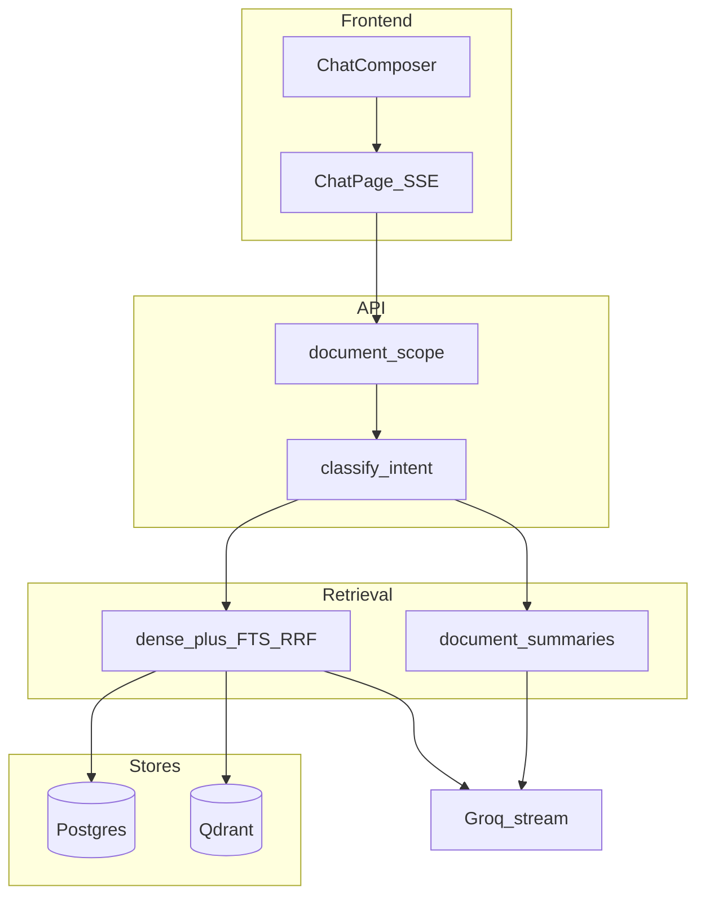

# DocChat

Multi-document RAG chat: FastAPI + PostgreSQL + Qdrant + Redis/ARQ + React.

**English-only:** OCR, summaries, FAQs, and chat answers are English. Non-English scans (e.g. Arabic) will OCR poorly.

Phases **1–7** are implemented: auth, ingestion, document intelligence, hybrid retrieval, sessions/SSE chat, Groq orchestration, and the DocChat UI. Phase **8** (hardening / eval) is deferred on purpose — see [What I'd do with more time](#what-id-do-with-more-time).

## Stack

- **Frontend:** React + TypeScript + Tailwind (Vite)
- **API:** Python 3.11, FastAPI, SQLAlchemy 2, Alembic
- **Data:** PostgreSQL (app data + BM25 `tsvector`), Qdrant (dense vectors), Redis + ARQ
- **Extraction:** PyMuPDF, PaddleOCR, Tesseract fallback
- **Embeddings:** OpenRouter `nvidia/llama-nemotron-embed-vl-1b-v2:free` (2048-dim)
- **Retrieval:** dense + Postgres FTS, RRF fusion (local reranker off by default), citations
- **LLM:** Groq `openai/gpt-oss-20b` (summaries, FAQs, grounded chat)

## Quick start

```bash
cp .env.example .env
# Set GROQ_API_KEY for full LLM answers (fallbacks exist without it)
# Set OPENROUTER_API_KEY for embeddings

docker compose up --build
```

| Service  | URL                        |
|----------|----------------------------|
| UI       | http://127.0.0.1:5173      |
| API      | http://127.0.0.1:8001      |
| API docs | http://127.0.0.1:8001/docs |
| Postgres | localhost:5433             |
| Redis    | localhost:6379             |
| Qdrant   | http://localhost:6335      |

Bootstrap login: `admin@docchat.com` / `password`

### Frontend only (API already running)

```bash
cd frontend
npm install
npm run dev
```

## Screenshots

| Login | Chat + citations | Upload progress |
|-------|------------------|-----------------|
|  |  |  |

## Architecture overview

Request path in one sentence: the UI opens a chat session, posts a message over SSE, the API resolves `@filename` scope and intent, hybrid-retrieves chunks (or ingest summaries), builds a grounded prompt, streams Groq tokens, and filters citations to what the model actually used.



More detail:

- Chat / retrieval flow: [`architecture.md`](architecture.md)
- Stack + upload/ask flows (PDF): [`DocChat_Tech_Stack_and_Flows.pdf`](DocChat_Tech_Stack_and_Flows.pdf)

### Layout

```
backend/app/
  api/          # auth, documents, sessions, chat (SSE)
  rag/          # semantic, bm25, fusion, rerank, citations, prompts
  ingestion/    # parse, OCR, chunk, summarize, embed
  llm/          # Groq provider + rate limiter
  workers/      # ARQ ingestion
frontend/       # DocChat UI
```

### Chat API (SSE)

```bash
# after login cookies + CSRF
curl -N -b cookies.txt -X POST http://localhost:8000/sessions/{id}/chat \
  -H "Content-Type: application/json" \
  -H "X-CSRF-Token: $CSRF" \
  -d '{"message":"What is the coverage period in @Policy.pdf?"}'
```

Events: `status` → `sources` → `token`* → `done` (or `error`).

### Configuration

See [`.env.example`](.env.example): chunking, embedding/reranker models, retrieval top-k, relevance threshold, Groq limits, `@` scope via document filename.

### Tests

```bash
cd backend
pytest -q
```

### Phase status

| Phase | Status |
|-------|--------|
| 1 Foundation | Done |
| 2 Ingestion | Done |
| 3 Document intelligence | Done |
| 4 Hybrid retrieval | Done |
| 5 Sessions + SSE | Done |
| 6 LLM chat orchestration | Done |
| 7 Frontend | Done |
| 8 Hardening / eval | Deferred |

## Productionizing / scaling / cloud deploy

This compose stack is a **local demo**. To run it on a hyper-scaler I would treat it as five deployable pieces: API, worker, frontend, managed data plane, and object storage.

**What has to change before production**

- Secrets out of `.env` / bootstrap password — use a secret manager; rotate JWT/CSRF secrets; force HTTPS cookies (`SECURE_COOKIES=true`).
- Stop bind-mounting source into containers; build immutable images (API + worker from `backend/Dockerfile`, a real frontend production image with nginx or CDN).
- Uploads off the container filesystem → S3 / GCS / Azure Blob; store object keys in Postgres.
- Run Alembic as a release job, not on every API process start.
- Horizontal API replicas behind a load balancer; workers scale independently on the Redis/ARQ queue.
- Managed Postgres (RDS / Cloud SQL / Azure Database), managed Redis, Qdrant Cloud or self-hosted on a dedicated node pool (disk + RAM sized for 2048-d vectors).
- Rate limits and quotas per tenant; auth beyond a single bootstrap user (signup, or IdP/OIDC).
- Observability: structured logs, request IDs, Prometheus metrics (ingest latency, retrieval empty rate, LLM errors), traces (OpenTelemetry), and an LLM/RAG eval set so regressions are visible.

**Sketch on AWS (same shape maps to GCP/Azure)**

| Piece | AWS | GCP / Azure analogue |
|-------|-----|----------------------|
| API + worker | ECS Fargate or EKS | Cloud Run / GKE; Container Apps / AKS |
| Frontend | S3 + CloudFront (static) | Cloud Storage + CDN; Static Web Apps / Front Door |
| Postgres | RDS | Cloud SQL; Azure Database for PostgreSQL |
| Redis | ElastiCache | Memorystore; Azure Cache |
| Vectors | Qdrant Cloud or EC2/EKS | same |
| Files | S3 | GCS; Blob Storage |
| Secrets | Secrets Manager + IAM | Secret Manager; Key Vault |

**Cloudflare** fits well in front: WAF, bot protection, TLS, and caching the static UI. The API still needs a region close to Postgres/Qdrant; Workers alone are a poor home for OCR + long SSE + heavy Python deps unless you split a thin edge proxy from the RAG core.

**Scale bottlenecks I already hit locally:** OCR and embedding dominate ingest; Groq TPM/RPM need a limiter (already in-process); local cross-encoder rerank OOMs, so fusion-only is the default. In production I would isolate OCR/embed workers, batch embeddings, and keep the chat path thin (retrieve → prompt → stream).

## RAG / LLM approach & decisions

### Choices considered → final choice

| Concern | Considered | Chose | Why |
|---------|------------|-------|-----|
| Orchestration | LangChain / LlamaIndex | Thin custom FastAPI services | Fewer abstractions to debug; assignment is small enough that a framework’s “magic” hurt more than it helped |
| LLM | OpenAI, local Ollama, Groq | Groq `openai/gpt-oss-20b` | Fast streaming for SSE UX; free/cheap enough for a take-home; OpenAI-compatible client |
| Embeddings | local sentence-transformers, OpenAI | OpenRouter Nemotron VL 1B (2048-d) | No GPU required on my machine; free tier; good enough for English docs |
| Vector DB | pgvector-only, Chroma, Qdrant | Qdrant + Postgres FTS | Qdrant is purpose-built for dense search; Postgres already held chunks so BM25/`tsvector` was free hybrid without a second lexical engine |
| Chunking | fixed char windows | Structure-aware ~700 tokens / 100 overlap | Keeps headings with body; avoids ripping tables mid-row |
| Rerank | always-on cross-encoder | Off by default (`RERANKER_ENABLED=false`) | Local `bge-reranker-base` exhausted RAM; RRF fusion was “good enough” for demos |
| Ingest intelligence | retrieve-only | Summary + FAQs at ingest | Summarize/compare intents can answer without stuffing the whole doc into context |

### Prompt & context management

- System prompt forces English, grounded answers, Markdown, and `[n]` citations only for excerpts actually used (`backend/app/rag/prompt_builder.py`).
- Intent routing: `qa` / `summarize` / `compare` (+ chitchat bypass) so we do not always run the same retrieve-and-stuff path.
- `@filename` chips/mentions narrow retrieval scope before the query is embedded.
- History: last N turns kept; older turns summarized so the context window does not grow forever.
- Budget: context window minus output/prompt reserves (`llm_input_budget`) caps how many chunks we send.

### Guardrails

- Upload validation: extension, size, magic bytes.
- Cookie JWT + CSRF on mutating routes; CORS allowlist.
- Relevance threshold — refuse / “not in documents” when fused scores are weak instead of hallucinating.
- Citation filter post-stream so the UI does not show unused sources.
- Groq RPM/TPM rate limiter with retries.
- English-only policy documented and enforced in prompts (OCR quality collapses otherwise).

### Quality

- Unit tests for fusion, citations, `@` parsing, intent/prompts, auth helpers, validation, rate limiter.
- Manual smoke: upload → wait for ready → ask a fact that appears on a known page → check citation.
- **Not done:** golden-question eval harness, regression CI against a fixed corpus, LLM-as-judge — that is Phase 8.

### Observability

- Today: stdlib logging + `GET /health`.
- Missing for prod: metrics, traces, per-request RAG debug traces (query rewrite, hit list, scores), and alerting on ingest failures / empty retrieval rate.

## Key technical decisions

1. **Hybrid retrieval over dense-only** — keyword queries (“section 4.2”, policy numbers) miss in pure embedding space; FTS + RRF fixed that without a paid rerank API.
2. **Async ARQ workers for ingest** — OCR/embed can take minutes; the upload API must return quickly and the UI polls/progresses via status.
3. **SSE instead of WebSockets for chat** — one-way token stream is enough; simpler proxying and auth (same cookie session as REST).
4. **Dual write: Postgres chunks + Qdrant vectors** — one source of truth for text/metadata (and FTS), one for ANN; delete paths must touch both (acknowledged coupling).
5. **Single bootstrap user** — enough to demo ownership and CSRF; multi-tenant signup was out of scope for the time box.
6. **Compose-first DX** — one command for reviewers; production topology documented separately instead of half-implemented Terraform.

## Engineering standards I followed (and skipped)

**Followed**

- Clear package boundaries (`api` / `services` / `rag` / `ingestion` / `workers`)
- Typed settings via pydantic-settings; Alembic migrations for schema
- Auth that is actually usable (httpOnly cookies + CSRF), not a fake header demo
- Validation at the edge for uploads
- Unit tests for pure logic I knew would regress (fusion, citations, prompts)
- `.env.example` and English-only limitation called out up front
- Docker Compose so a reviewer is not hunting local Postgres/Qdrant installs

**Skipped (on purpose)**

- Full integration/e2e suite and frontend tests
- Strict mypy/`ruff` CI gate
- Production-hardened images / non-root / read-only rootfs
- Multi-tenancy, SSO, RBAC
- Eval harness and metrics (Phase 8)
- Perfect OCR for every scan quality

Trade-off: a solid, runnable path beats an unfinished “platform.”

## How I used AI coding tools

I used Cursor heavily as a pair programmer, not as an autopilot.

**Do’s**

- Ask for scaffolding (FastAPI routers, React components, Dockerfiles), then rewrite the parts that touch product judgment (prompts, retrieval thresholds, UX copy).
- Keep the agent inside one vertical slice at a time (ingest → retrieve → chat → UI) so diffs stay reviewable.
- Run the app and tests myself after agent edits — especially around SSE, cookies, and OCR, where “looks right” often is not.
- Use the agent to explain unfamiliar APIs (Qdrant filters, ARQ job context) then implement the thin wrapper myself when the first draft was over-abstracted.

**Don’ts**

- Do not paste the assignment README and accept the first generated architecture.
- Do not let the model invent LangChain graphs when a 200-line service is clearer.
- Do not commit `.env` or keys the agent helpfully “filled in.”
- Do not outsource the *thinking* sections of this README — reviewers can smell generic prose; the decisions above are ones I actually made while debugging empty retrieval, OOM reranks, and CSRF failures.

Repeatability: `.env.example`, Compose, and pytest are the contract. Agent chats are disposable; the repo should stand alone.

## What I'd do with more time

- Phase 8: small golden set (10–20 Q&A pairs), offline retrieval metrics, and a CI job that fails on retrieval regressions.
- Turn the cross-encoder back on via a remote rerank API or a dedicated GPU worker.
- Object storage for uploads; production Docker images; Terraform or CDK for one cloud.
- OpenTelemetry + a simple RAG trace UI (query → hits → prompt hash → latency).
- Multi-user auth, document sharing, and delete/re-ingest hardening.
- Broader formats (DOCX) and better OCR language packs — still English-first unless product scope changes.
- Frontend e2e (Playwright) for login → upload → cited answer.
- Rate Limit and Handling LLM for concurrency
- File and chat retention and auto delete data job


## Known limitations

- English-only OCR and answers.
- Local reranker disabled by default (memory).
- No signup; bootstrap admin only.
- Observability is logs + health only.
- Unit tests only — no full ingest/chat integration tests in CI.
- Compose ports (5433 / 6335 / 8001) are shifted to avoid clashing with other local stacks.
- no blocking for unreadble files or low quality images also not tested

## License / notes

Built as a take-home demonstration. Swap API keys in `.env` before running; never commit secrets.
